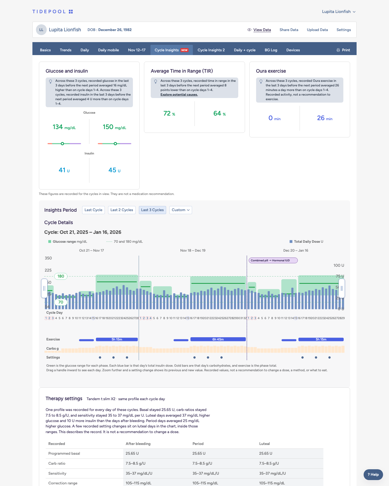
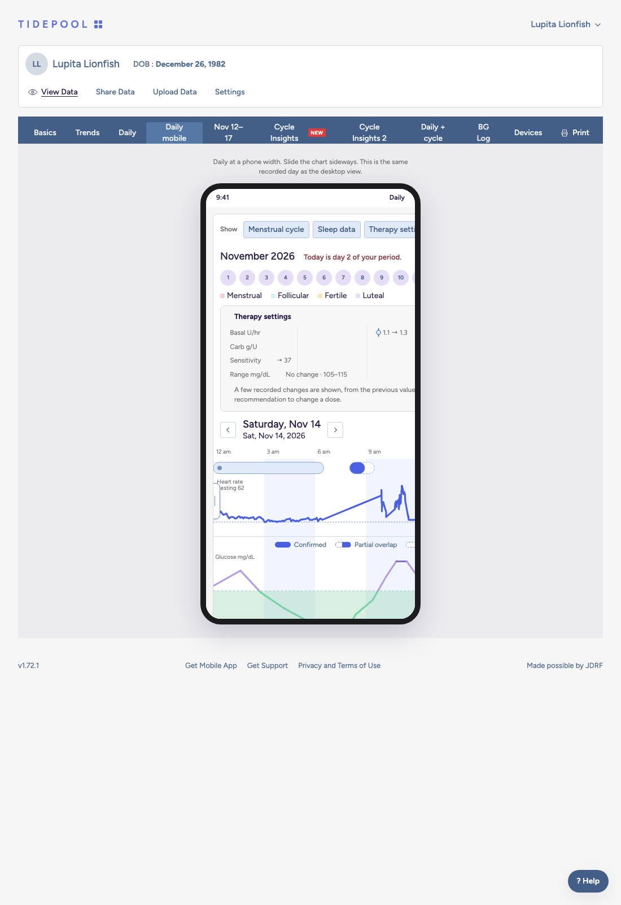

# Tidepool Daily

A desktop prototype of Tidepool’s Daily view, restyled in the Cycle Insights visual system. It shows a recorded sample day, the week of Nov 12–17, and three cycles from Oct 21, 2025 to Jan 16, 2026.

The sample person is Lupita Lionfish. Glucose and insulin on these screens are a recorded sample. Oura sleep, activity, and tags appear when a ring is connected. Figures describe the record. They are not a recommendation to change a dose, a method, or what to eat.

The same screens are in Figma on the discovery board: [Daily, 7 day, and Cycle Insights](https://www.figma.com/design/ae4O74howmad6XvUu6zIVA?node-id=9835-1160).

## Daily

Saturday, Nov 14 is the sample day. The heart-rate, glucose, carb, bolus, and basal lanes are tall enough to read the swings and still fit a desktop window. The plot runs the full width of the chart. The Time in Range card lines up with the 70–180 mg/dL band.

This day stays outside that band more than the earlier sample: lows near 51 and 56 mg/dL, and highs that sit at the top of the glucose lane. The recorded insulin total stays 38.4 U. Carb meals stay on the chart. The side panel shows the Oura day when a ring is connected, and the therapy table lists the recorded t:slim X2 settings.


## Nov 12–17

One chart per day, newest first, with a shared pair of resize handles. Saturday is the higher-variation sample: 164 mg/dL average, 51% in range, 38.4 U.


## Cycle Insights

Last 3 Cycles is the default span. The plot has no grey fill and runs the full width of the container. Axis numbers sit on the left and right edges. Period days are outlines. A mark on Dec 20 records a method change from combined pill to hormonal IUD.

Three cards compare cycle days 1–4 with the last 3 days before the next period: glucose and insulin, time in range, and Oura exercise. Carbs are one gold bar per day. Drag a handle inward to read a shorter span.



## Cycle Insights 2

The same three cycles, with carbohydrate intake drawn three ways under the exercise row:

- **Shade.** One cell per day. Darker gold is more grams.
- **By phase.** A phase average while the full span is in view. Zoom in and each day gets its own bar and gram label.
- **Vs average.** A line of daily grams against a dashed line for the average of the cycles on screen.

Drag either handle, or circle a span, to move from the phase summary to the daily grams. Exercise names and setting text appear once the window is narrow enough.


## Daily mobile

The same Saturday, inside a phone frame. The chart is wider than the phone and scrolls sideways.



## Run

```bash
node oura-server.mjs
```

Open http://127.0.0.1:8787/

Oura data is optional. Copy `.env.example` to `.env` and add an Oura application client id and secret. `.env` stays on this machine.
